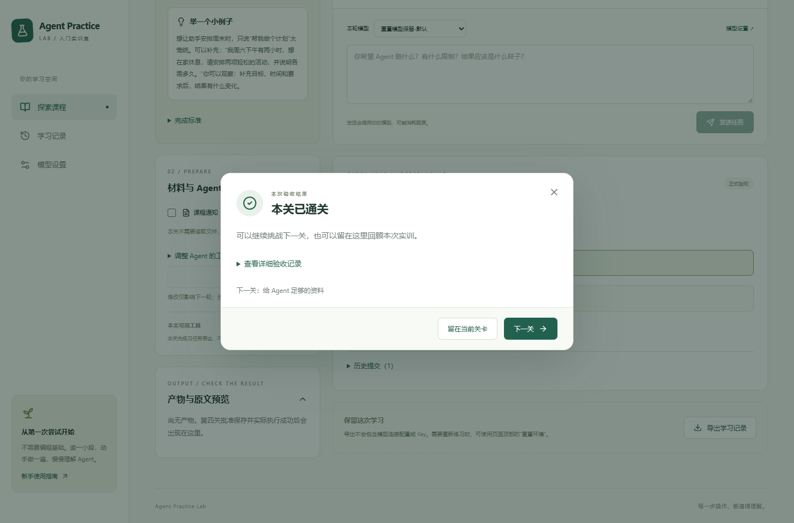
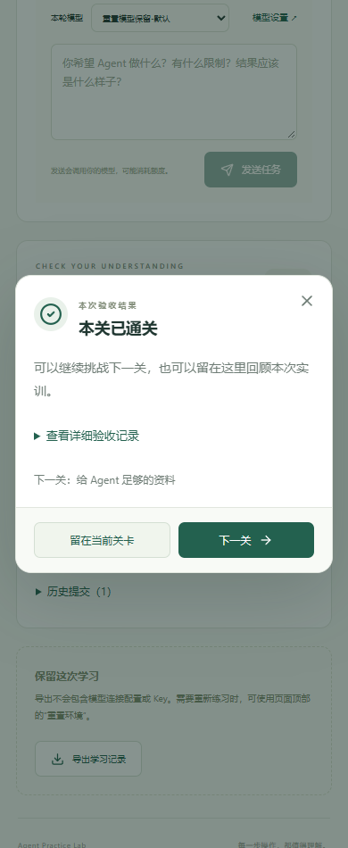
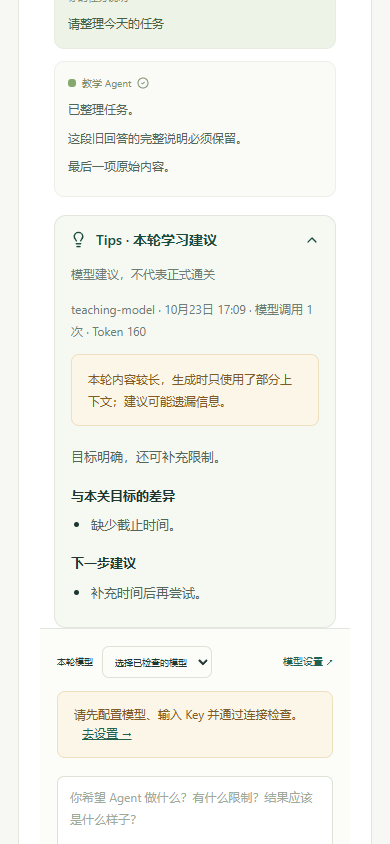
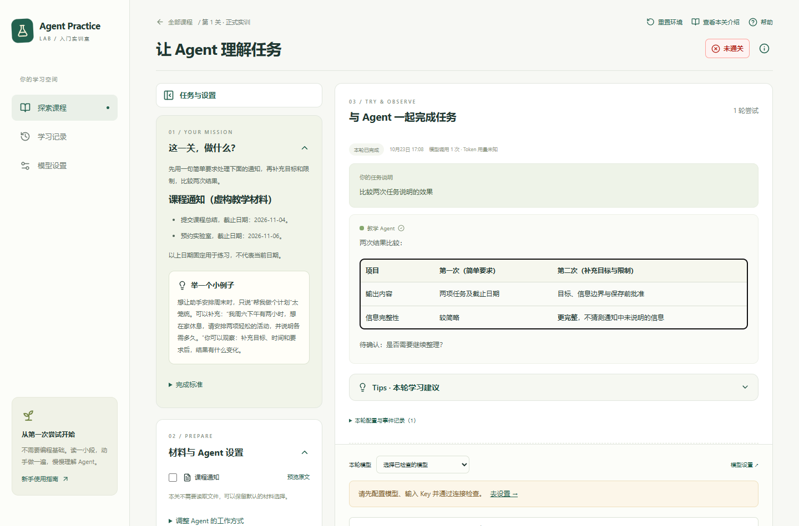
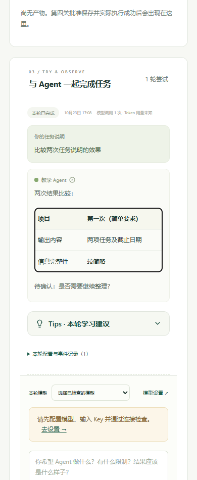

# Tips 与实训交互交付记录

日期：2026-10-23。交付分支为 [feat/practice-tips-and-feedback](https://github.com/2791243700-hue/agent-practice-lab/tree/feat/practice-tips-and-feedback)，基于 main `55ce473`；本轮上传不直接合并主分支。当前状态以[版本索引](project-status.md)为准。

## 本轮变化

- 模型主回答使用简洁任务结果的指令，教学建议集中到默认收起的 Tips；历史原文不裁剪。
- 展开 Tips 只读取缓存。没有结果时，明确确认所选服务商、发送内容与额外额度消耗后，再请求一次模型。结果按运行保存，刷新、重复展开、清除 Key 或重启后仍可查看；失败仅由用户主动重试，重试可能再次产生费用。
- Tips 只展示总结、与目标的差异和下一步建议，不显示单独的“依据”。新模型输出要求三项内容；既有响应结构保留 evidence 字段，新结果置为空数组，旧缓存不改写。
- 评价上下文先过滤流式分片，再截取完整消息和实际工具/授权结果。平台提供已完成运行数、不同任务说明数量、本关可用工具及公开核对题提示，避免把内部日志整理问题归咎于学生。不提供私有评分答案。
- 顶部“重置环境”恢复同版本、同模式的默认材料和设置，保留历史记录、Key、当前模型选择与连接检查；跳转和刷新不会切回默认模型。
- Markdown 支持标准管道表格；宽表格在容器内横向滚动，手机页面不会被撑开，不启用原始 HTML。
- 提交验收后自动显示简短弹窗，可选“下一关”或“留在当前关卡”，最后一关可返回课程列表。下一关先进入导读并保留模型选择。未通过可继续修改，演示结果不计正式通关；关闭或刷新不会自动重开历史弹窗。
- 详细验收记录与快照下载默认收起；历史提交可主动打开，查看运行事件时先关闭弹窗，再展开、定位和聚焦目标记录。

## 接口和保存边界

契约仍为 v0.1.0，新增 GET/POST `/runs/{run_id}/tips`，合计 39 个 HTTP 操作、92 个 schema、11 类事件。请求和错误行为见[接口契约](../contracts/README.md)，操作步骤见[使用说明](user-guide.md)。

Tips 使用当前所选且已通过连接检查的配置，单次无工具请求，不改变正式评分、运行或历史提交。生成期间复用全局执行槽并锁定配置；不同幂等键也不会并发重复调用。异常响应有大小和结构校验，错误信息净化，输出脱敏后保存。Key 始终只在后端内存中。

若进程在已发出请求后中断而未确认结果，该轮会保留待处理标记并阻止再次生成，避免无意重复扣费。没有自动清除该标记或自动再次请求的入口；可以继续新的一轮。Tips 用量单列，不代表服务商完整账单。

## 最终验证

上传前对本轮最终源码重新验证：137 项后端测试、15 项前端测试、204 项契约结构检查、Ruff、Web 格式、TypeScript 和隔离生产构建通过。完整 42 项浏览器回归全部通过，覆盖四关、Tips、表格、重置与结果弹窗；阶段明细见[前端验证记录](frontend-validation.md)。

测试使用隔离数据、虚构凭据、MockTransport 或本机脚本模型，不修改正在体验的学习库；构建不在正在运行的开发目录执行。独立复审发现并修复了异常服务商响应、弹窗事件链接定位和关闭后焦点恢复问题。具体阶段记录见[后端验证](runtime-validation.md)与[前端验证](frontend-validation.md)。

用户曾提供实际 DeepSeek Tips 截图，暴露了上下文截断误判及技术用语问题，已据此修正。改进后建议的教学质量、模型对简洁指令的遵循仍需后续真实服务商和零经验学生验证；脚本结果不等于外部模型验收。

## 界面截图

以下均来自隔离自动化的虚构数据。

## 已知限制与运行状态

模型建议可能有误，正式通关仍由后端验收决定。主回答简洁度由指令引导，不通过截断强制实现。已生成 Tips 保持原结果，不自动重新评价或产生费用。

本轮上传不重启正在体验的服务。此前用户确认过一次后端重启，已加载流式证据整理修复；后续移除依据的界面立即生效，但不再请求依据的后端提示词需要下次后端启动时加载。新克隆并启动本分支会使用全部最新代码。整个后端进程重启仍需重输内存 Key，关卡重置不需要。

第四关 task_id 教学指导、生成类型 discriminator、启动器等待前端就绪和真实服务商浏览器验收继续见[已知待办](project-status.md)。没有新增登录、班级或线上部署。
